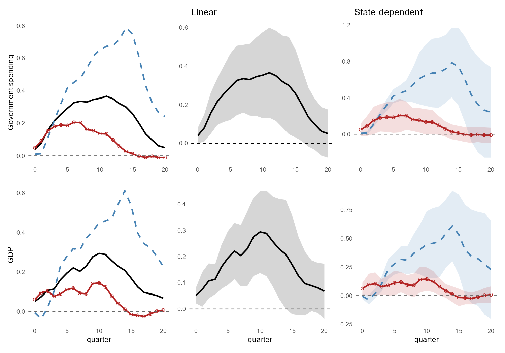
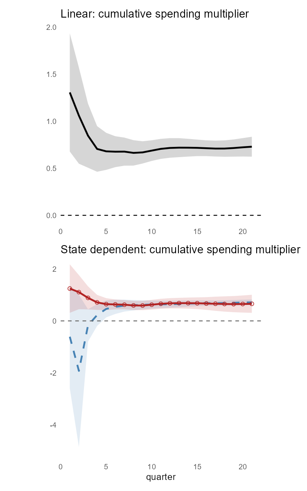
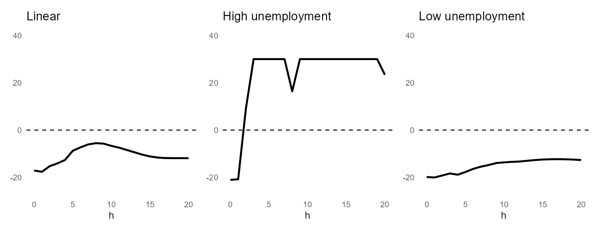

# Government Spending Multipliers: Local Projections in R

A partial replication of **Ramey and Zubairy (2018)**, "Government Spending Multipliers in Good Times and in Bad: Evidence from US Historical Data", *Journal of Political Economy*, 126(2): 850–901. <https://doi.org/10.1086/696277>

> **Scope:** This repository replicates the local-projection core of the paper: the impulse responses in Figure 5, the cumulative multipliers in Figure 6, the news-shock relevance diagnostics in Figure 4, and the headline multipliers in Tables 1–2. The Blanchard-Perotti IV tables, the zero-lower-bound state, the WWII-exclusion and post-WWII subsamples, and Anderson-Rubin tests are not replicated. The primary purpose is to demonstrate state-dependent local projections and one-step IV multipliers with HAC inference in R. A short write-up is in `report/ramey-zubairy-replication-summary.pdf`.

------------------------------------------------------------------------

## Overview

Does the government spending multiplier rise when the economy is slack? The paper uses quarterly US data for 1889–2015 and Ramey's military-news shock to estimate linear and state-dependent local projections (Jordà, 2005). The state is high unemployment (lagged unemployment ≥ 6.5%). The pipeline has three scripts:

| Script | Purpose | Outputs |
|------------------------|------------------------|------------------------|
| `01_data_prep.R` | Load `RZDAT.xlsx`, build `y`, `g`, news shock and slack state | `data/processed/rzdat_prepped.rds` |
| `02_lp_function.R` | Lag controls, linear and state-dependent LP estimators, plotting, Figure 5 | `figure5_*.png` |
| `03_cumulative_multiplier.R` | One-step IV multipliers, first-stage diagnostics, Figures 4 and 6, NBER-recession check | `figure4_F_news.png`, `figure6_multipliers.png`, `multiplier_comparison.csv` |

------------------------------------------------------------------------

## Data

`RZDAT.xlsx` is the authors' public replication dataset (quarterly, 1889q1–2015q4, 508 observations after filtering). Following Gordon and Krenn, real GDP and real government spending are divided by potential GDP, so responses read directly as multipliers. Place the file in `data/raw/`.

------------------------------------------------------------------------

## Results

Cumulative news-shock multipliers, this replication against the paper (standard errors in parentheses; the full table with NBER-recession splits is in `output/tables/multiplier_comparison.csv`):

| Specification     | Horizon | This replication | Paper        |
|-------------------|---------|------------------|--------------|
| Linear            | 2-year  | 0.664 (0.069)    | 0.66 (0.067) |
| Linear            | 4-year  | 0.713 (0.043)    | 0.71 (0.044) |
| High unemployment | 2-year  | 0.603 (0.102)    | 0.60 (0.095) |
| Low unemployment  | 2-year  | 0.595 (0.089)    | 0.59 (0.091) |
| High unemployment | 4-year  | 0.682 (0.055)    | 0.68 (0.052) |
| Low unemployment  | 4-year  | 0.668 (0.125)    | 0.67 (0.121) |

Output and spending both respond more in the high-unemployment state, but the multipliers are about 0.6–0.7 in both. The HAC test of equal multipliers gives p = 0.954 (2-year) and 0.924 (4-year), as in the paper.

**Figure 5 — Responses to a news shock** (government spending on top, GDP below; linear, state-dependent)



**Figure 6 — Cumulative multipliers** (linear on top, state-dependent below)



**Figure 4 — First-stage relevance** (F minus the 23.1 threshold; the instrument is strong in the high-unemployment state and weak in the low-unemployment state)



------------------------------------------------------------------------

## Notes on Deviations from the Paper

| Aspect | Paper | This replication | Reason |
|------------------|------------------|------------------|------------------|
| Software | Stata / MATLAB | R | Learning objective |
| HAC for IRF bands | Automatic bandwidth | Fixed lag of 4 | Simplification |
| HAC for multipliers | `ivreg2, bw(auto)` | Newey-West (1994) automatic bandwidth, no prewhitening (`sandwich`) | Closest R equivalent; standard errors differ by up to about 0.007 |
| First-stage F | Olea-Pflueger effective F (`weakivtest`) | Squared HAC t-statistic on the instrument | Equal to the robust F with one instrument; levels differ somewhat |
| Weak-instrument tests | Anderson-Rubin | Not implemented | Out of current scope |
| Blanchard-Perotti shock | IV instrument | Side exercise: LP with contemporaneous spending as the shock | Not a replication of a published table |

------------------------------------------------------------------------

## Repository Structure

```         
ramey-zubairy-2018-lp/
├── R/
│   ├── 01_data_prep.R
│   ├── 02_lp_function.R
│   └── 03_cumulative_multiplier.R
├── data/
│   ├── raw/RZDAT.xlsx
│   └── processed/                    ← generated; git-ignored
├── output/
│   ├── figures/                      ← Figures 4, 5, 6
│   └── tables/multiplier_comparison.csv
├── reference/
│   └── jordagk.do                    ← authors' Stata script, used as the specification guide
├── report/
│   ├── ramey-zubairy-replication-summary.qmd                    ← Quarto source
│   └── ramey-zubairy-replication-summary.pdf                    ← 4-page write-up
└── README.md
```

------------------------------------------------------------------------

## Reproducing

Run the scripts from the project root, in order: `R/01_data_prep.R`, `R/02_lp_function.R`, `R/03_cumulative_multiplier.R`. To rebuild the report: `quarto render report/ramey-zubairy-replication-summary.qmd`.

**R packages:** `readxl`, `dplyr`, `purrr`, `sandwich`, `lmtest`, `AER`, `ggplot2`, `patchwork`.

------------------------------------------------------------------------

## Citation

> Ramey, V. A. and Zubairy, S. (2018), "Government Spending Multipliers in Good Times and in Bad: Evidence from US Historical Data", *Journal of Political Economy*, 126(2): 850–901. <https://doi.org/10.1086/696277>

------------------------------------------------------------------------

## Author

Amal Varghese \| MA Economics, Yonsei University \| [github.com/amalzmv-013](https://github.com/amalzmv-013)
