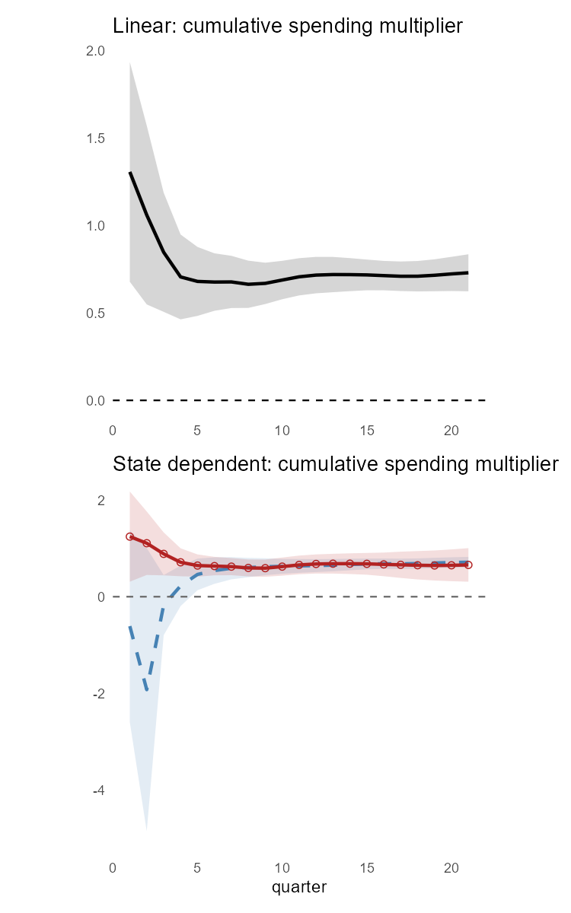
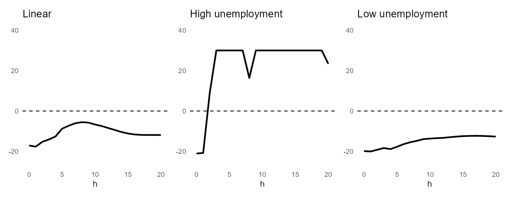

# Question and scope

Ramey and Zubairy (2018) ask whether the government spending multiplier is larger when the economy is slack. Using quarterly U.S. data for 1889--2015, they find multipliers of roughly 0.6--0.7 in *both* states, i.e. no evidence that spending is more effective in slack. This note reproduces their linear and state-dependent impulse responses (Figure 5), the cumulative multipliers (Figure 6), the first-stage relevance diagnostics for the military-news instrument (Figure 4), and the headline multipliers in Tables 1--2. The purpose is to learn the associated toolkits in R, not to replicate every robustness exercise: the Blanchard-Perotti IV tables, the zero-lower-bound state, and the subsample exercises are out of scope.

# Data and variables

The data are Ramey's public replication file, quarterly 1889q1--2015q4 (508 observations). Following the Gordon--Krenn normalization, real GDP and real government spending are divided by potential GDP (a sixth-degree polynomial trend in log GDP), so that responses can be read directly as multipliers:
$$y_t = \frac{Y_t}{Y^{pot}_t}, \qquad g_t = \frac{G_t / P_t}{Y^{pot}_t}, \qquad newsy_t = \frac{news_t}{Y^{pot}_{t-1}P_{t-1}} .$$
The shock is Ramey's military-news variable. The slack state is $I_{t-1}=1$ when the *lagged* unemployment rate is at least 6.5% (181 of the usable quarters), so the state is predetermined. WWII is kept in the baseline sample. Controls $z_{t-1}$ are four lags each of $newsy$, $y$ and $g$.

# Method

Each horizon $h=0,\dots,20$ is a separate regression (Jordà, 2005). The linear and state-dependent LPs are $$x_{t+h} = \alpha_h + \psi_h(L)\,z_{t-1} + \beta_h\,shock_t + \varepsilon_{t+h}, \tag{1}$$ $$\begin{aligned}
x_{t+h} ={}& I_{t-1}\left[\alpha_{A,h}+\psi_{A,h}(L)z_{t-1}+\beta_{A,h}\,shock_t\right] \\
&+ (1-I_{t-1})\left[\alpha_{B,h}+\psi_{B,h}(L)z_{t-1}+\beta_{B,h}\,shock_t\right] + \varepsilon_{t+h},
\end{aligned} \tag{2}$$ with $x\in\{y,g\}$. The cumulative multiplier is estimated in one step by instrumenting cumulative spending with the shock: $$\sum_{j=0}^{h} y_{t+j} = \gamma_h + \phi_h(L)\,z_{t-1} + m_h \sum_{j=0}^{h} g_{t+j} + q_{t+h}, \tag{3}$$ and the state-dependent version (4) interacts every term of (3) with $I_{t-1}$ and $1-I_{t-1}$, giving $m_{A,h}$ (slack) and $m_{B,h}$ (non-slack). Implementation choices:

- **Inference.** IRF bands use Newey--West errors with a fixed lag of 4 (a simplification of the paper's automatic bandwidth). Multiplier errors use the Newey--West (1994) automatic bandwidth without prewhitening, mirroring `ivreg2, bw(auto)` in the authors' Stata code.
- **State dependence.** One IV per regime (all controls interacted, regime-specific intercepts) gives each multiplier and its standard error; a joint IV supplies the covariance for a HAC Wald test of $m_A=m_B$.
- **Validation.** On a common sample, the one-step IV equals the ratio of summed IRFs; this holds to seven digits at the 2-year horizon.
- **Relevance.** The first-stage F is the squared HAC $t$-statistic on the instrument, compared with the Olea--Pflueger threshold of 23.1 (one instrument, 5% level). It is computed with `sandwich` rather than Stata's `weakivtest`, so levels can differ somewhat.

# Results

## Impulse responses

In the linear model, output and spending peak roughly ten to twelve quarters after a news shock (spending about 0.37, output about 0.29). In the state-dependent model both respond much more in the high-unemployment state (spending peaks near 0.79 and output near 0.61 around quarter 14), but because spending rises about as much as output, this does not imply a larger multiplier.

{width="80%"}

## Cumulative multipliers

The linear multiplier starts above one at impact (output reacts to news before spending does) and settles near 0.7 by the second year. The two state-dependent paths are very different and imprecise over the first quarters and coincide from about the second year onward. The table below compares the headline 2- and 4-year multipliers with the paper; point estimates agree to two decimals and standard errors to within about 0.007. The HAC test of equal multipliers across the unemployment states gives $p=0.954$ (2-year) and $0.924$ (4-year), as in the paper; for the NBER split it is $0.71$ and $0.88$.

{width="33%"}

| Specification      | Horizon | Replication (s.e.) | Paper (s.e.) |
|:-------------------|:--------|:------------------:|:------------:|
| Linear             | 2-year  |   0.664 (0.069)    | 0.66 (0.067) |
| Linear             | 4-year  |   0.713 (0.043)    | 0.71 (0.044) |
| Unemployment: high | 2-year  |   0.603 (0.102)    | 0.60 (0.095) |
| Unemployment: low  | 2-year  |   0.595 (0.089)    | 0.59 (0.091) |
| Unemployment: high | 4-year  |   0.682 (0.055)    | 0.68 (0.052) |
| Unemployment: low  | 4-year  |   0.668 (0.125)    | 0.67 (0.121) |
| NBER: recession    | 2-year  |   0.627 (0.192)    |  0.63 (--)   |
| NBER: expansion    | 2-year  |   0.547 (0.084)    |  0.55 (--)   |
| NBER: recession    | 4-year  |   0.673 (0.234)    |  0.67 (--)   |
| NBER: expansion    | 4-year  |   0.640 (0.051)    |  0.64 (--)   |

: Replication versus the paper (news-shock multipliers; paper: Tables 1--2).

## Instrument relevance

The news shock is a strong instrument in the high-unemployment regime from about the first year (first-stage $F\approx 210$ at the 2-year horizon) but weak in the low-unemployment regime ($F\approx 8$), and weak at the shortest horizons in both. In the linear case $F$ peaks near 18, below the 23.1 threshold. This fits the paper's explanation that the largest news shocks (the WWII and Korean War buildups) arrived when unemployment was already high. Under the NBER split, $F$ in the expansion regime rises to about 15, which is consistent with WWII being an NBER expansion, although we did not isolate this. The occasional notch in $F$ under automatic bandwidth (for example at quarter 8) disappears at fixed lags, so it reflects bandwidth selection and not the data.

{width="76%"}

# Takeaways and limitations

Output responds more in slack states, but so does spending, so multipliers are about 0.6--0.7 in both states and below one; the replication reproduces the paper's conclusion. HAC tests of state differences rely on strong instruments, which fails in the low-unemployment regime; the paper adds Anderson--Rubin tests, which are not implemented here. The Blanchard-Perotti IV tables, the ZLB state, the WWII exclusion and the post-WWII subsample are not replicated. A Blanchard-Perotti-style LP (contemporaneous spending as the shock) is included in `R/02_lp_function.R` as a side exercise, not as a replication of a published table. All results can be reproduced by running `R/01_data_prep.R`, `R/02_lp_function.R` and `R/03_cumulative_multiplier.R` in that order.

# References {.unnumbered}

Jordà, Ò. (2005). Estimation and inference of impulse responses by local projections. *American Economic Review* 95(1), 161--182.

Montiel Olea, J. L. and Pflueger, C. (2013). A robust test for weak instruments. *Journal of Business & Economic Statistics* 31(3), 358--369.

Newey, W. K. and West, K. D. (1994). Automatic lag selection in covariance matrix estimation. *Review of Economic Studies* 61(4), 631--653.

Ramey, V. A. and Zubairy, S. (2018). Government spending multipliers in good times and in bad: Evidence from U.S. historical data. *Journal of Political Economy* 126(2), 850--901.
